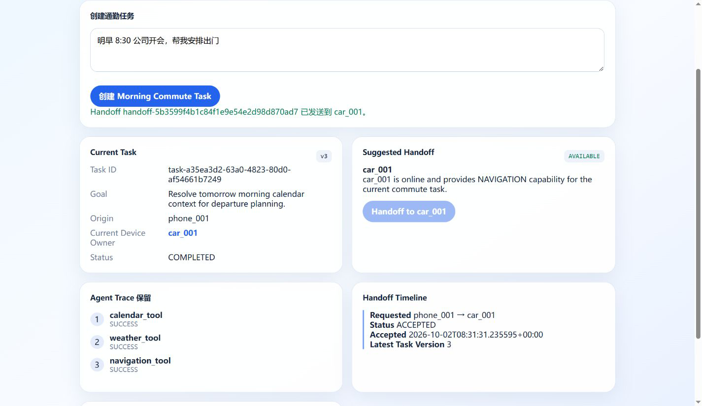
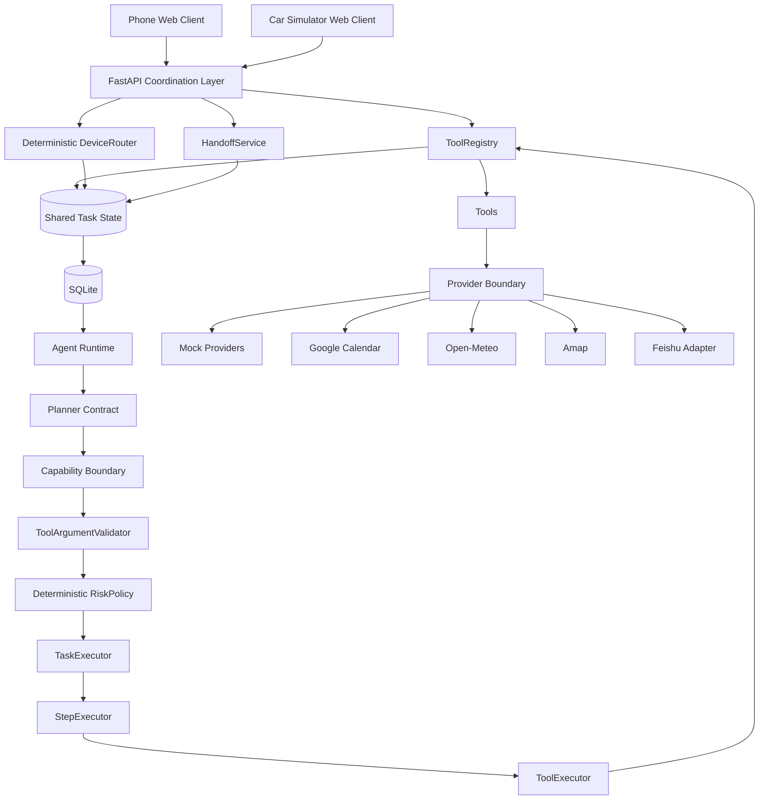
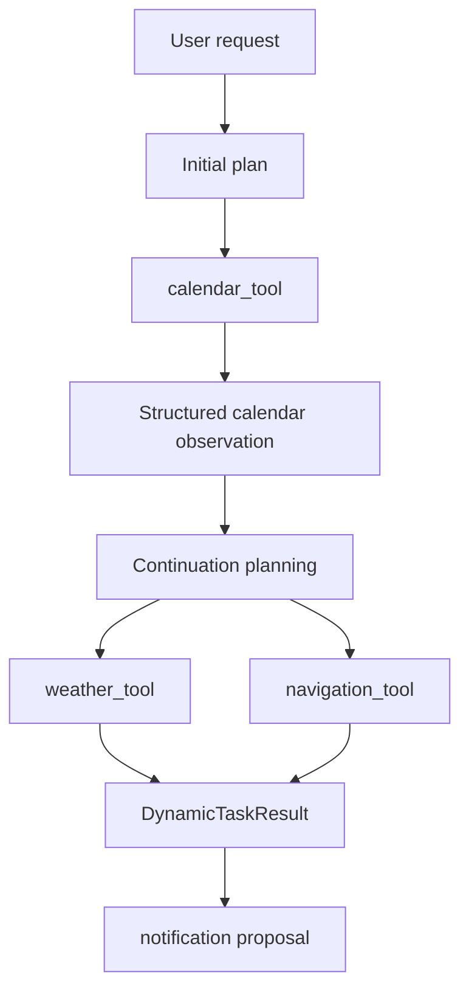
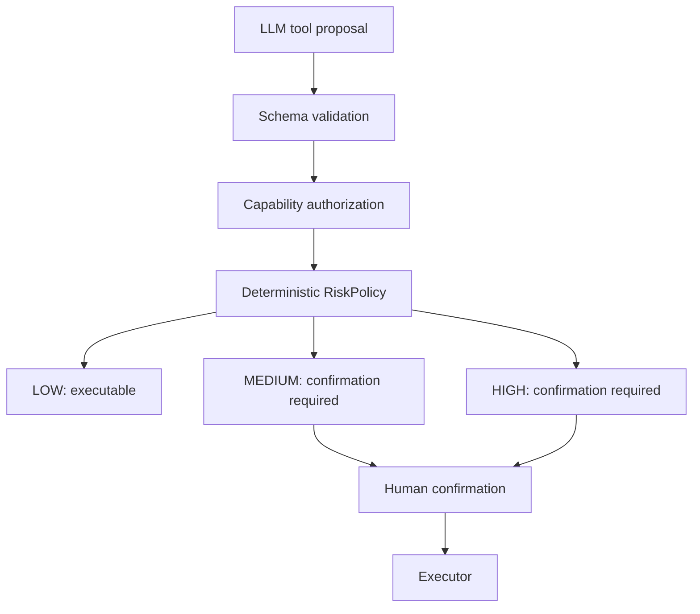
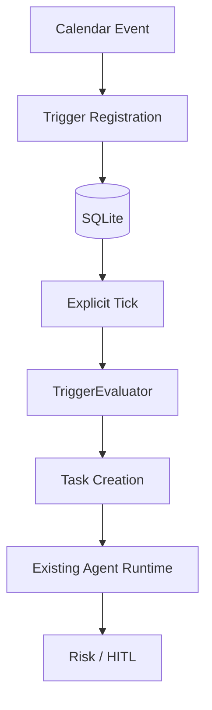
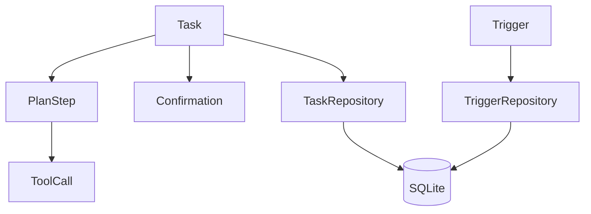

# FlowMate｜跨设备主动式智能生活 AI Agent

FlowMate 是一个以 Task Continuity 为核心的跨设备主动式 AI Agent 原型，让用户在手机端创建的任务可以携带上下文和执行状态接力到车辆端，而无需重新描述需求。

> **让同一个 AI Task 在手机与车辆界面之间保持连续，通过设备能力路由、上下文接力和统一安全确认，实现跨端任务不中断。**

**English subtitle**: FlowMate — Cross-device Proactive AI Agent.  
**English tagline**: A cross-device proactive AI agent prototype that keeps the same task, context, and execution state continuous across phone and car interfaces.



## 三个核心卖点

### 01 Cross-device Task Continuity

同一用户、同一 `task_id`、同一上下文在 Phone Web Client 与 Car Simulator 间流转。Task 属于用户，而不是某台设备。

### 02 Safe Agent Execution

跨端接力不能绕过确定性 RiskPolicy、Tool schema、能力授权或 Human-in-the-loop。并发确认使用 version claim，避免重复状态转换和重复副作用。

### 03 Dynamic + Proactive Planning

Calendar observation 驱动 Weather / Navigation continuation；持久化 Trigger 通过显式 tick 主动生成任务，但不会自动执行副作用。

## 真实状态

| Evidence | Result |
| --- | --- |
| Independent clients | Phone Web + Car Web Simulator |
| Shared Task demo | Phone → Car → Phone view update, same `task_id` |
| Backend regression | `739 passed`, 0 failed |
| Frontend build | PASS, 22 modules |
| Cross-device Eval V1 | 16 cases, 11 metrics at 1.000 |
| Real hardware claim | None; no OEM vehicle or real device control |

## Product Problem

普通多端助手往往把每台设备当成独立聊天窗口：用户已经在手机上说明会议、目的地和时间，上车后却要重新描述。FlowMate 把核心对象从“设备上的对话”改成“可在设备间流转的 Task”：Task 持有目标、上下文、执行状态和安全状态，设备只临时承载当前交互表面。

## Demo A — Cross-device Morning Commute

```text
Phone: “明早 8:30 公司开会，帮我安排好出门”
  -> Calendar / Weather / Navigation
  -> Task prepared; current_device = phone_001
  -> car_001 heartbeat ONLINE
  -> deterministic Device Router recommends car_001
  -> Phone requests Handoff: PENDING
  -> Car receives and accepts the same task_id/context
  -> current_device = car_001; version increments
  -> Phone next poll sees Car takeover
```

Morning Commute 是 Agent execution foundation：日程 observation、天气、路线和通知建议先形成可追踪 Task；Cross-device coordination 再接力已有 Task，不重新运行 Planner 或 Calendar。

## Cross-device Task Continuity

```text
Phone Client
    | create Task
    v
Shared Task: task_id = xxx, current_device = phone_001
    | deterministic Device Router
    v
Handoff: phone_001 -> car_001, status = PENDING
    | Car accepts
    v
Shared Task: current_device = car_001, version = N + 1
    | Phone polls coordination state
    v
Phone sees Car takeover, same task_id and context
```

### What this demo proves

- Two independent Web clients and explicit device identity.
- Device capability registry and online/offline presence.
- One shared persisted Task rather than a duplicate Task per device.
- Minimized context handoff, state synchronization and restart persistence.
- Optimistic concurrency and multi-client confirmation consistency.

### What this demo does NOT claim

- No real OEM vehicle integration or real vehicle control.
- No native Android/iOS application or native mobile push.
- No production authentication or multi-tenant authorization.
- No WebSocket/SSE; V1 uses 2-second coordination polling.
- No real smart-home control.

真实运行截图与其证明内容见 [Screenshot Evidence](docs/portfolio/screenshots.md)。

## 核心能力

| Capability | Current status |
| --- | --- |
| Cross-device continuity | Same persisted Task across `/phone` and `/car`, with routing, handoff, versioning and sync |
| Device routing | Deterministic from presence + capability + Task context; Router never transfers silently |
| Planner contract | RuleBasedPlanner 与 LLMPlanner 共用 `plan(user_input) -> Task` |
| Structured output | LLM 输出先进入 PlannedTask/PlannedStep，再确定性转换为 Task |
| Tool execution | ToolRegistry -> ToolExecutor -> StepExecutor -> TaskExecutor |
| Dynamic planning | Calendar observation 驱动 Weather / Navigation continuation |
| Safety | Capability authorization + schema validation + deterministic RiskPolicy |
| HITL | MEDIUM/HIGH 风险动作等待用户确认，拒绝后不执行 |
| Persistence | SQLite task history 与 trigger history |
| Proactive trigger | 显式 tick，不做后台 scheduler，不自动执行副作用 |
| Frontend demo | `/phone` Phone Web Client + `/car` Car Simulator Web Client |

## Cross-device Architecture



## Dynamic Planning



This is the core product idea: Plan -> Act -> Observe -> Re-plan -> Act.

## Safety / HITL



LLM-generated risk metadata is not trusted. Risk is recomputed by deterministic backend policy from tool name and action semantics.

## Proactive Agent



Proactive does not mean autonomous side effect. Stage 26 uses explicit tick and idempotency checks; no background scheduler is introduced.

## Persistence



Persistence is task history and trigger state, not long-term memory. It stores structured state and avoids provider secrets.

## Real Integrations

| Capability | Mock | Real adapter | Real verification |
| --- | --- | --- | --- |
| Calendar | YES | Google Calendar read-only | PASS |
| Weather | YES | Open-Meteo | PASS |
| Navigation | YES | Amap | PASS |
| Notification | YES | Feishu webhook | ENGINEERING READY / real delivery PENDING |
| SmartHome | YES | -- | Mock only |
| Vehicle | YES | -- | Mock only |

Vehicle capability intentionally uses mock execution to demonstrate action-aware risk and HITL without unsafe real-device control. SmartHome follows the same product boundary.

## Real-world Grounding Highlight

Stage 23.1 exposed a useful product lesson: HTTP success does not equal semantic correctness, and schema validity does not guarantee real-world grounding.

The user destination “人民广场” was initially resolved to the wrong region, producing a valid but unusable long-distance route. The fix introduced origin geographic context, Amap POI region constraints, city limit, and defensive region validation. After that, the route grounded to 上海市人民广场 with a practical local route. Real route distance and duration may vary with provider data and traffic.

## Evaluation

Planner Eval V3 reads the current saved result from `evals/results/llm_planner_v3_stage20.json`.

| Metric | Value |
| --- | ---: |
| Dataset size | 36 |
| Scenario Accuracy | 0.9722 |
| Tool Selection Accuracy | 0.9583 |
| Parameter Accuracy | 0.9375 |
| Parameter Completeness | 1.000 |
| Supported Recall | 0.9583 |
| Unsupported Recall | 1.000 |
| Schema Valid Rate | 0.9722 |
| Extra Tool Rate | 0.000 |

Proactive Trigger Eval V1 reads `evals/results/proactive_trigger_eval_v1.json`.

| Metric | Value |
| --- | ---: |
| Cases | 12 |
| Registration Accuracy | 1.000 |
| Due Detection Accuracy | 1.000 |
| Expiration Accuracy | 1.000 |
| Duplicate Trigger Prevention | 1.000 |
| Duplicate Fire Prevention | 1.000 |
| Restart Idempotency | 1.000 |
| Task Creation Accuracy | 1.000 |
| Side-effect Containment | 1.000 |

Cross-device Eval V1 reads `evals/results/cross_device_eval_v1.json`.

| Metric | Value |
| --- | ---: |
| Cases | 16 |
| Device Registration Accuracy | 1.000 |
| Routing Accuracy | 1.000 |
| Capability Match Accuracy | 1.000 |
| Offline Device Rejection | 1.000 |
| Handoff Creation Accuracy | 1.000 |
| Duplicate Handoff Prevention | 1.000 |
| Handoff Acceptance Accuracy | 1.000 |
| Wrong-user Isolation | 1.000 |
| Restart Persistence | 1.000 |
| Confirmation Consistency | 1.000 |
| State Sync Accuracy | 1.000 |

Quality is separated into engineering tests, planner evaluation, trigger evaluation, real provider smoke, frontend build, and secret boundary audit.

## Frontend Demo

Frontend lives in `frontend/`.

Current validated local toolchain:

- Node `v12.16.1`
- npm `6.13.4`
- Vue `3.2.47`
- Vite `2.9.18`
- TypeScript `4.9.5`

This is a validated local compatibility baseline for the portfolio demo, not a recommended modern production baseline.

## How to Run

Install backend dependencies:

```powershell
pip install -r requirements.txt
```

Run backend:

```powershell
$env:FLOWMATE_DEMO_MODE="true"
$env:FLOWMATE_DB_PATH="data/flowmate_demo.db"
uvicorn main:app --reload --host 127.0.0.1 --port 8000
```

Seed deterministic demo data when needed:

```powershell
python scripts/demo_seed.py
```

Run frontend:

```powershell
cd frontend
npm install
npm run dev
```

Open two independent client routes (replace the port if Vite selects another one):

- Phone Web Client: `http://localhost:5173/phone`
- Car Simulator Web Client: `http://localhost:5173/car`

The Car page sends a heartbeat, then the Phone page can recommend and request a handoff. Both pages poll coordination state every 2 seconds.

Run the offline Stage 29 smoke and deterministic eval:

```powershell
python scripts/cross_device_handoff_smoke.py
python scripts/eval_cross_device.py
```

Build frontend:

```powershell
cd frontend
npm run build
```

Run backend tests:

```powershell
python -m pytest
```

## Demo Mode

`FLOWMATE_DEMO_MODE=true` switches provider runtime to mock providers:

- Mock Calendar
- Mock Weather
- Mock Navigation
- Mock Notification

Agent core remains real code: Planner, RiskPolicy, Executors, Persistence, Trigger evaluation and HITL still run through the same backend path. Mock is a provider option, not a fake product path.

## Project Structure

```text
flowmate/
  agent/        Planner, executors, risk, dynamic orchestration
  api/          FastAPI read/write demo APIs
  cross_device/ Device registry, router, handoff, shared state
  demo/         Demo service composition
  persistence/  SQLite repositories
  providers/    Real and mock provider boundaries
  tools/        Tool contracts and tool implementations
frontend/
  src/          Vue workspace and API clients
evals/
  results/      Saved evaluation outputs
docs/
  portfolio/    Portfolio, interview and release materials
scripts/        Smoke tests, eval runners, demo seed/reset
tests/          Offline regression tests
```

## Key Design Decisions

- Mock-first: keep offline demo stable while preserving real provider contracts.
- Provider boundary: Tools do not embed vendor networking details.
- Rule baseline + LLM planner: compare deterministic baseline and model planner.
- Structured output: LLM output is validated before becoming domain state.
- Tool schema as source of truth: arguments are validated before execution.
- Deterministic RiskPolicy: safety is not delegated to the model.
- Explicit tick: proactive behavior remains controlled and testable.
- SQLite V1: enough for local auditability without introducing production infrastructure.
- Task-centered handoff: Task owns context; a device only owns the current execution surface.
- Polling V1: 2-second coordination polling is sufficient for the local portfolio demo; SSE/WebSocket is a future transport option, not a Stage 29 dependency.

More detail: [docs/portfolio/design_decisions.md](docs/portfolio/design_decisions.md).

## Current Limitations

- Feishu real delivery is engineering-ready but final real-send verification is pending.
- SmartHome and Vehicle are mock-only by design; no real device control is included.
- Phone is a Web Client and Car is a Web Simulator; there is no native mobile app or real vehicle integration.
- Cross-device identity is a single-user demo model, not production authentication; there is no login, JWT, OAuth, RBAC, or multi-tenant boundary.
- V1 synchronization uses 2-second polling, not WebSocket/SSE, and does not provide distributed multi-instance coordination.
- No distributed scheduler, distributed queue, HA deployment, RAG, memory or LangGraph.
- Frontend dependencies are pinned for the current local Node 12 environment; modernization is a future maintenance item.
- Portfolio evidence contains eight real local-runtime screenshots; they are not mockups or AI-generated images.

## Portfolio V1 Scope

Included:

- LLM planning
- Six tool capabilities
- Dynamic re-planning
- Risk / HITL
- Real information providers
- Persistence
- Proactive trigger
- Frontend demo
- Minimal Phone-to-Car shared-Task handoff
- Evaluation framework

Not included:

- Production authentication
- Multi-user support
- Native mobile push
- Real vehicle control
- Real smart-home control
- Distributed scheduler or queue
- Multi-instance trigger coordination

## Interview Highlights

1. Same-Task Phone-to-Car continuity: same user, `task_id` and context across independent clients.
2. Deterministic device capability routing plus explicit Handoff state machine.
3. Optimistic concurrency and confirmation consistency across clients.
4. Observation-driven dynamic re-planning.
5. Deterministic RiskPolicy plus human confirmation.
6. Three-layer Planner / Trigger / Cross-device evaluation.
7. Real-world POI grounding instead of trusting HTTP success.

Start with [docs/README.md](docs/README.md) for the full portfolio reading path.
