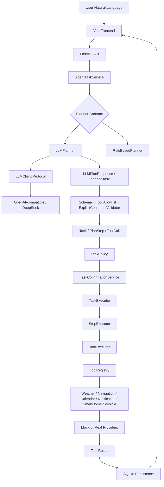

# FlowMate 完整产品说明书
## Controlled Proactive AI Agent Portfolio V1

面向 AI 产品经理 / Agent 产品经理的产品、架构、评测与面试手册。

本文基于仓库中的代码、测试、前端、API、Provider、Eval 与文档重新审计生成。它不是代码实现文档，而是产品说明书：目标是让没有参与开发的人看完后，能理解 FlowMate 为什么做、给谁用、怎么工作、能力边界在哪里、为什么这样设计，以及如何在面试中讲清楚。

**Current Verification Snapshot**

| 项目 | 当前结果 |
|---|---|
| 后端测试 | `python -m pytest`，`697 passed in 13.69s` |
| 前端构建 | `npm run build` 成功，退出码 0 |
| 前端产物 | `frontend/dist/index.html`，`assets/index.29677c72.js` |
| 当前默认 Tool Mode | `mock` |
| Real Information Mode | `FLOWMATE_TOOL_MODE=real_information` 启用 Open-Meteo + Amap |
| 当前主 Agent API | `POST /api/v1/agent/tasks` |
| 当前 Agent API 返回 | `AgentTaskResult { task, notification_task, dynamic_state }` |
| 当前 Planner Eval V3 Gold Dataset | `evals/planner_eval_v3.json`，38 cases |
| 历史真实 LLM 快照 | `evals/results/llm_planner_v3_stage20.json`，36 cases |

注意：Stage 28.3 文档记录过 `695 passed`。当前代码经过后续修复后，真实测试结果已变为 `697 passed`。本文使用当前结果。

---

## 1. FlowMate 是什么？

### 15 秒版本

FlowMate 是一个受控主动 AI Agent 原型：用户用自然语言提出生活协同任务，系统把它规划成结构化步骤，调用工具执行信息查询或 Mock 动作，并通过风险策略与人工确认控制副作用。

### 30 秒版本

FlowMate 面向 AI 产品经理作品集场景，展示一个 Agent 产品从自然语言输入到任务规划、工具调用、执行轨迹、风险分级、人机确认、持久化和评测的完整链路。它不是生产级消费 App，也没有真实控制车辆或智能家居；它通过 Mock Provider 保证安全演示，并接入了 Open-Meteo 和 Amap 等真实信息类 Provider 做真实世界验证。

### 1 分钟版本

FlowMate 解决的问题是：普通 Chatbot 可以回答，但很难可靠地把用户的多步骤现实目标拆成可执行、可审计、可控的行动。FlowMate 把 Agent 拆成 Planner、Schema、Validator、RiskPolicy、Executor、Tool、Provider、Persistence 和 Frontend。LLM 只负责规划提案，不直接执行工具；工具参数经过 Pydantic 和显式约束校验；风险由后端确定性策略计算；中高风险动作进入 Human-in-the-loop。项目同时保留 RuleBasedPlanner、Fake LLM 测试、Gold Eval、真实 Provider 快照和真实信息 Provider E2E 验收，用来区分 Demo 成功、工程链路成功和真实模型/真实世界可用性。

---

## 2. 产品背景

### 2.1 为什么做 FlowMate？

【产品假设 / Portfolio MVP】FlowMate 从“早晨通勤、日程、天气、路线、提醒、安全动作”切入，因为这类场景天然包含多步骤协同：用户不是只问一个问题，而是希望系统理解目标、查询上下文、组织步骤、必要时提醒或等待确认。

### 2.2 用户遇到的核心问题

用户在现实生活中经常需要在多个应用之间切换：看日程、查天气、估算路线、判断是否需要提前出门、设置提醒。普通聊天界面可以给建议，但不能可靠地产生结构化执行记录，也难以解释某一步为什么做、做到了哪里、是否有风险。

### 2.3 普通 Chatbot 为什么不够？

Chatbot 主要输出自然语言。它容易出现三个问题：

- 缺少可执行结构：回答里说“我会帮你查”，但系统不一定真的形成 ToolCall。
- 缺少权限边界：模型可能把不支持的动作说成可以做。
- 缺少执行审计：用户很难知道任务是否完成、哪个工具失败、风险是否经过确认。

### 2.4 为什么需要 Agent？

这里的 Agent 不是“完全自主循环”，而是受控工作流：自然语言输入进入 Planner，Planner 生成 Task / PlanStep / ToolCall，再由确定性 Executor 执行。Agent 的价值在于把“意图”变成“可验证步骤”。

### 2.5 为什么强调“受控”？

FlowMate 明确区分 Planning 与 Authorization。LLM 可以提出计划，但不能越过工具白名单、参数校验、风险策略、人机确认和 Provider 边界。这个设计避免把模型的语言自信误当成系统能力。

### 2.6 为什么从生活协同 / 通勤切入？

通勤任务足够具体，能展示日程、天气、路线、动态重规划和提醒；同时风险可控，真实信息 Provider 也容易验证。它适合作品集 MVP，不代表当前已经是生产级 Consumer App。

---

## 3. 目标用户

### 3.1 产品设想中的最终用户

目标用户是日程、出行、设备协同频繁的人：例如每天需要协调会议、路线、天气、提醒和家庭设备的人。他们希望 AI 不只是回答问题，而是协同处理多个步骤。

### 3.2 当前 Portfolio Demo 的直接用户

当前直接用户不是大规模 C 端用户，而是：

- 项目作者本人：用于学习 Agent 产品设计和面试表达。
- AI 产品经理 / Agent 产品经理面试官：评估候选人是否理解 LLM、Tool Calling、安全边界和 Eval。
- 对代码不熟但有 AI 基础的评审者：通过前端和文档理解系统能力。

---

## 4. 用户需求与 JTBD

核心 JTBD：

> 当我有一个多步骤现实目标时，我希望 AI 理解目标、规划步骤并协调工具，这样我不用在多个应用之间手动切换，也能知道系统做了什么、哪里需要我确认。

| 需求 | 用户问题 | FlowMate 解决方式 | 当前完成度 |
|---|---|---|---|
| 信息查询 | 明天天气怎样、路线多久 | WeatherTool / NavigationTool | Mock 默认；Open-Meteo / Amap 可在 real_information 模式启用 |
| 多步骤任务 | 明早开会，安排出门 | Task / PlanStep / ToolCall 顺序执行 | 已实现 |
| 出行安排 | 从 A 到 B，保留时间和地点 | LLMPlanner + ExplicitConstraintValidator + NavigationTool | 已实现，仍依赖 Provider grounding |
| 风险动作 | 解锁车、控制灯 | RiskPolicy + HITL | Mock 工具已实现，真实物理控制未实现 |
| 主动服务 | 日程触发、动态提醒 | Calendar trigger、DynamicTaskOrchestrator、Notification side-effect | 原型已实现，真实推送默认未启用 |
| 不支持能力 | 写邮件、真实驾驶、定时通知 | UnsupportedPlanningScenarioError / HTTP 422 | 已实现 |
| 结果追踪 | 执行后怎么看结果 | SQLite history、Agent Timeline、Task JSON | 已实现 |

---

## 5. 核心用户旅程

```text
自然语言输入
-> Planner
-> Structured Task
-> Validation
-> RiskPolicy
-> Confirmation
-> Executor
-> Tool
-> Provider
-> Result
-> Persistence
-> Frontend
```

每一层解决的产品问题：

- 自然语言输入：降低用户表达成本。
- Planner：把模糊目标拆成结构化步骤。
- Structured Task：让任务可以被执行、存储和评测。
- Validation：防止工具名、参数、显式时间地点被模型破坏。
- RiskPolicy：后端确定性判断风险，而不是完全相信 LLM。
- Confirmation：中高风险动作等待用户授权。
- Executor：可靠地按顺序执行，失败时停止。
- Tool：提供能力边界和参数契约。
- Provider：隔离 Mock 与真实服务。
- Result：记录结构化结果或错误。
- Persistence：让历史、审计和前端刷新可用。
- Frontend：把 Agent 内部状态呈现给用户。

---

## 6. 核心产品功能

| 功能 | 用户价值 | 内部机制 | 用户可见 | 当前状态 | 对应代码 |
|---|---|---|---|---|---|
| 自然语言任务输入 | 不需要手写参数 | `AgentTaskService` + `LLMPlanner` | 是 | 已实现 | `flowmate/agent/agent_task_service.py` |
| LLM Planner | 灵活理解自然语言 | Structured output + Pydantic | 间接可见 | 已实现 | `flowmate/agent/llm_planner.py` |
| RuleBasedPlanner | 稳定 baseline | 关键词规则 | 否 | 保留 | `flowmate/agent/rule_based_planner.py` |
| Structured Output | 让模型输出可验证 | `LLMPlanResponse` | 否 | 已实现 | `flowmate/schemas/planner.py` |
| 显式约束保护 | 防止时间地点被默认值覆盖 | `ExplicitConstraintValidator` | 间接可见 | 已实现 | `flowmate/agent/explicit_constraint_validator.py` |
| Task / Step / ToolCall | 任务可执行、可审计 | Pydantic domain model | 是 | 已实现 | `flowmate/schemas/` |
| Tool Registry | 控制可用工具集合 | `ToolRegistry` | 否 | 已实现 | `flowmate/tools/registry.py` |
| TaskExecutor | 执行已规划任务 | 顺序执行、fail fast | 间接可见 | 已实现 | `flowmate/agent/task_executor.py` |
| StepExecutor | 执行单步 | 校验 tool_name 一致性 | 否 | 已实现 | `flowmate/agent/step_executor.py` |
| ToolExecutor | 执行 ToolCall | 参数校验、结果写回 | 间接可见 | 已实现 | `flowmate/agent/tool_executor.py` |
| RiskPolicy | 控制副作用风险 | 确定性规则 | 是 | 已实现 | `flowmate/agent/risk_policy.py` |
| HITL | 中高风险动作需确认 | `TaskConfirmationService` | 是 | 已实现 | `flowmate/agent/task_confirmation.py` |
| Unsupported | 不支持时拒绝而非瞎做 | Planner exception / HTTP 422 | 是 | 已实现 | `flowmate/api/agent.py` |
| Persistence | 历史和审计 | SQLite aggregate | 是 | 已实现 | `flowmate/persistence/` |
| Recent Tasks | 查看历史任务 | `/api/v1/tasks` | 是 | 已实现 | `flowmate/api/tasks.py` |
| Agent Timeline | 展示执行轨迹 | 前端基于 Task + dynamic_state 渲染 | 是 | 已实现，但非 event sourcing | `frontend/src/App.vue` |
| Trigger | 主动日程触发 | Calendar trigger repository | 是 | 已实现原型 | `flowmate/triggers/` |
| Evaluation | 量化 Planner 能力 | Gold datasets + Evaluator | 是 | 已实现 | `flowmate/eval/` |
| Provider Mode | Mock/Real 信息切换 | `FLOWMATE_TOOL_MODE` | 是 | 已实现 | `flowmate/tools/runtime_registry.py` |
| Responsive Frontend | 可演示产品体验 | Vue + Vite | 是 | 已实现 | `frontend/src/` |

---

## 7. 核心 Agent 架构



### 为什么 Planner 和 Executor 分开？

Planner 决定“要做什么”，Executor 负责“可靠地做”。如果 LLM 直接执行工具，就很难在执行前校验工具名、参数、风险和授权。分离后，系统可以在执行前拦截不合法计划。

### 为什么 LLM 不直接执行 Tool？

LLM 输出可能幻觉、遗漏字段或过度选择工具。FlowMate 让 LLM 只输出结构化计划；真正的 ToolCall 必须经过 Pydantic、Tool allowlist、参数校验、RiskPolicy 和 HITL。

### 为什么 Tool Registry 独立？

Tool Registry 是能力目录。Planner 只能选择注册过的工具，Executor 只能执行注册过的工具。Provider 如何实现不进入 Planner。

### 为什么 RiskPolicy 不完全交给 LLM？

风险是产品安全决策，不能只由概率模型判断。FlowMate 用确定性后端策略把 `notification_tool` 归为 MEDIUM，把 `vehicle_tool unlock` 归为 HIGH，并强制进入确认。

---

## 8. LLM Planner

LLMPlanner 的职责是：

1. 接收用户输入。
2. 调用 LLMClient 获取结构化输出。
3. 用 `LLMPlanResponse` 校验 provider envelope。
4. 校验 tool allowlist 和 step order。
5. 校验 tool arguments。
6. 校验显式时间地点约束。
7. 转换为 `Task / PlanStep / ToolCall`。
8. 交给 RiskPolicy 修正风险和确认状态。

输入是自然语言，输出是 `Task`。LLM 不生成 Task id、Step id、ToolCall status、result、error，这些由 Python 确定性代码生成。

### 为什么不让 LLM 输出自然语言？

自然语言无法稳定执行，也很难评测。结构化输出让系统知道工具名、参数、风险和步骤顺序。

### 为什么 JSON 仍然需要 Validation？

JSON 格式正确不代表业务正确。例如工具名可能不存在、参数字段可能多余、时间可能被降级、地点可能被默认值覆盖。因此需要 Pydantic、ToolArgumentValidator、ExplicitConstraintValidator。

### 为什么 Planner 不应拥有执行权限？

因为 Planning 不是 Authorization。模型可以建议“发送通知”或“解锁车辆”，但是否允许执行必须由后端策略和用户确认决定。

### Provider 与 Retry

真实 LLM Provider 通过 `OpenAILLMClient` 接入。DeepSeek endpoint 使用 OpenAI-compatible chat completions JSON mode。`RetryingLLMClient` 对 provider transport、empty output、invalid JSON、parse error 做最多 2 次尝试。最近修复把 DeepSeek JSON 输出预算提升到 `8192`，避免大 prompt 下 reasoning token 消耗完导致 content 为空。

---

## 9. RuleBasedPlanner

项目保留 RuleBasedPlanner 不是为了替代 LLMPlanner，而是为了：

- 建立最早的可测 baseline。
- 在 Eval 中对比规则系统与 LLM 的边界。
- 证明 Planner Contract 可以支持多个实现。

| 维度 | RuleBasedPlanner | LLMPlanner |
|---|---|---|
| 稳定性 | 高，确定性 | 受模型影响 |
| 灵活性 | 低，只支持有限表达 | 高，可理解更多自然语言 |
| 成本 | 低，无模型调用 | 有模型成本和延迟 |
| 延迟 | 快 | 依赖 Provider |
| 可解释性 | 强，规则可读 | 需要 Eval 和日志辅助解释 |
| 长尾能力 | 弱 | 强一些，但需要约束 |
| 参数漂移 | 少 | 可能发生，需 validator |
| 适用场景 | baseline / 离线测试 | 当前自由文本主链路 |

当前自由文本主链路使用 LLMPlanner，并在特定动态通勤/提醒请求上进入 DynamicTaskOrchestrator。

---

## 10. 显式约束保护

真实问题案例：

用户说：“我明天 9 点从心理所出发。”

早期模型可能生成：

```json
{
  "origin": "home",
  "departure_time": "tomorrow morning"
}
```

这是严重 Agent 问题，因为用户明确给出的约束被默认值覆盖了。对出行任务而言，起点和时间不是文案细节，而是工具执行的核心参数。

当前原则：

```text
用户显式输入 > 确认后的上下文 > Tool Observation > 默认值
```

`flowmate/agent/explicit_constraint_validator.py` 负责抽取显式导航约束，并校验 LLM 生成的 navigation_tool arguments 是否保留日期、时刻、起点、目的地。它解决的问题包括：

- Constraint Preservation：不丢用户明确说出的信息。
- Grounding：让工具参数扎根于用户输入或观察结果。
- Prompt 不可靠：Prompt 说“保留约束”仍可能失败，必须程序侧校验。
- 模型语义降级：防止 `09:00` 变成 `morning`。

---

## 11. Tool Calling

| Tool | 用户用途 | 输入参数 | 输出 | 副作用 | Mock Provider | Real Provider | 默认模式 | 风险 | 当前完成度 |
|---|---|---|---|---|---|---|---|---|---|
| `weather_tool` | 查询天气 | `location`, `date` | 天气、温度、降雨概率 | 无 | `MockWeatherProvider` | `OpenMeteoWeatherProvider` | Mock | LOW | Mock + Real 信息已验收 |
| `navigation_tool` | 路线、距离、耗时 | `origin`, `destination`, `departure_time` | 距离、时长、交通 | 无 | `MockNavigationProvider` | `AmapNavigationProvider` | Mock | LOW | Mock + Real 信息已验收 |
| `calendar_tool` | 只读日程查询 | `date`, optional `start_time`, `end_time` | events | 无 | `MockCalendarProvider` | `GoogleCalendarProvider` adapter | Mock | LOW | Adapter 存在，默认未启用真实 Calendar |
| `notification_tool` | 即时 Mock 通知 | `title`, `message`, `channel=mobile` | notification id/status | 有通知副作用 | `MockNotificationProvider` | `FeishuWebhookNotificationProvider` adapter | Mock | MEDIUM | Mock 默认；真实飞书发送不作为默认生产能力 |
| `smart_home_tool` | Mock 灯/空调即时控制 | `device_id`, `device_type`, `action`, optional `value` | mock state | Mock 副作用 | 内置 Mock | 无真实 Provider | Mock | MEDIUM | Mock only |
| `vehicle_tool` | Mock 车辆状态/有限控制 | `vehicle_id`, `action`, optional `temperature` | mock state | Mock 副作用 | 内置 Mock | 无真实 Provider | Mock | LOW/MEDIUM/HIGH 取决于 action | Mock only |

重点边界：SmartHome 和 Vehicle 工具当前不会控制真实设备或真实车辆。

---

## 12. Provider 架构

FlowMate 明确区分：

```text
Tool = 能力契约
Provider = 具体实现
```

例如：

```text
navigation_tool -> MockNavigationProvider
navigation_tool -> AmapNavigationProvider
```

Planner 不需要知道 Provider。Planner 只选择 `navigation_tool` 和参数；运行时由 ToolRegistry 注入 Mock 或 Real Provider。

### Runtime Mode

`FLOWMATE_TOOL_MODE=mock`：

- 默认安全模式。
- Weather、Navigation、Calendar、Notification、SmartHome、Vehicle 都走 Mock 或 Mock-like 实现。
- 适合离线演示、测试和无副作用运行。

`FLOWMATE_TOOL_MODE=real_information`：

- 只启用真实信息类 Provider：Open-Meteo weather 和 Amap navigation。
- Calendar、Notification、SmartHome、Vehicle 仍保持 Mock。
- 不根据 API key 自动切换，不做自动 Mock fallback。

---

## 13. 真实 Provider

### 13.1 Open-Meteo

【Real Provider】Open-Meteo 用于真实天气信息查询。Stage 28.3 记录的真实验收包括“帮我看看明天北京的天气”，最终只调用 `weather_tool`，返回 Open-Meteo 天气结果。

边界：

- 只读信息查询。
- 不控制设备。
- 城市解析需要 resolver；已为北京/上海等中文城市做确定性 alias。
- Provider 数据可能随时间变化。

### 13.2 Amap

【Real Provider】Amap 用于真实路线信息查询。Stage 28.3 验收输入包括“我明天上午 9 点从上海虹桥站出发去人民广场”，最终调用 `navigation_tool`，返回上海本地路线。

能力：

- POI / 地理位置解析。
- 驾车路线估算。
- 距离和时长归一化到 `NavigationToolResult`。

边界：

- 不驾驶车辆。
- 不控制交通。
- Provider 数据和实时路况会变化。
- 地点歧义需要 grounding 处理。

### 13.3 Google Calendar

【Real Adapter】代码中存在 `GoogleCalendarProvider` 和 OAuth 相关测试。当前默认运行不启用真实 Google Calendar；正式产品说明中不能把它说成默认真实使用。Mock Calendar 是当前演示主路径。

### 13.4 Feishu

【Real Adapter】代码中存在 `FeishuWebhookNotificationProvider`。当前默认 Notification 是 Mock。Feishu 工程链路存在，但真实发送不作为默认生产能力，也不在安全演示中自动触发。

---

## 14. Amap Grounding 案例

这是 FlowMate 最重要的真实世界问题之一。

用户目的地：

```text
人民广场
```

早期真实 Provider 解析可能把它落到错误地区，曾出现类似：

```text
上海虹桥站 -> 人民广场
1919.6 km
1258 minutes
```

形式上：

- HTTP 200。
- Schema valid。
- ToolCall SUCCESS。

但产品上完全不可用。这不是 HTTP Error，也不是 Schema Error，而是 Real-world Grounding Failure。

当前解决方案：

- 使用起点城市/区域上下文约束目的地 POI。
- 对跨区域歧义目的地做 re-grounding。
- 明确跨城市地点仍允许，例如用户显式说“北京天安门”。

产品启示：

```text
Schema Valid != Semantic Correct != Real-world Correct
```

Agent 产品不能只看 API 成功率，还要看结果是否符合真实世界语义。

---

## 15. RiskPolicy

RiskPolicy 是确定性后端策略，不由 LLM 最终决定。

| 风险等级 | 典型工具 / 动作 | 是否需要确认 |
|---|---|---|
| LOW | weather、navigation、calendar read、vehicle get_status | 否 |
| MEDIUM | notification、smart_home control、vehicle climate | 是 |
| HIGH | vehicle lock / unlock | 是 |

案例：“解锁我的车”

Planner 可以生成：

```text
vehicle_tool / unlock
```

但后端 RiskPolicy 会把它提升为：

```text
risk_level = HIGH
requires_confirmation = true
status = WAITING_CONFIRMATION
confirmation_status = PENDING
```

原因：LLM 可以理解用户意图，但不应拥有最终风险裁决权。

---

## 16. Human-in-the-loop

ConfirmationStatus：

- `NOT_REQUIRED`：无需确认。
- `PENDING`：等待用户确认。
- `CONFIRMED`：用户已确认。
- `REJECTED`：用户已拒绝。

典型流程：

```text
PLANNED / PENDING
-> request_confirmation
WAITING_CONFIRMATION / PENDING
-> confirm
PLANNED / CONFIRMED
-> TaskExecutor
COMPLETED
```

拒绝流程：

```text
WAITING_CONFIRMATION / PENDING
-> reject
CANCELLED / REJECTED
```

产品原则：

```text
Planning != Authorization
```

规划可以提前发生，但执行有副作用的动作必须等待用户授权。

---

## 17. Unsupported Capability

案例：“帮我写一封邮件给老板”

当前结果：

- HTTP 422。
- Unsupported planning scenario。
- 不创建可执行 Task。

为什么不能用 `notification_tool` 替代 email？

因为 capability boundary 要匹配用户真实目标。通知工具只能发送即时 Mock mobile notification，不能发送邮件、短信、微信，也不能伪装成 email tool。

主要 unsupported：

- 邮件写作/发送。
- Calendar write：创建、修改、取消、改期日程。
- 定时/延迟/条件通知。
- 真实车辆移动、远程驾驶、召唤、发动机控制。
- 真实智能家居控制。
- unsupported smart-home 设备，如窗帘、电视、门锁、摄像头。
- vehicle fuel/battery/location/speed 等未提供 telemetry。
- RAG、Memory、多用户权限、移动端 App。

---

## 18. Executor

产品表达：

```text
Planner = 决定做什么
Executor = 可靠地做
```

### TaskExecutor

只执行 `PLANNED` 且满足确认条件的 Task。按 `PlanStep.order` 排序执行。任一步失败则 Task FAILED 并停止后续步骤。

### StepExecutor

执行单个 PlanStep。它校验 `step.tool_name` 与 `tool_call.tool_name` 一致，避免计划和工具调用错配。

### ToolExecutor

从 ToolRegistry 获取工具，校验输入 schema，执行工具，写回 `ToolCall.status/result/error`。

---

## 19. Persistence

FlowMate 使用 SQLite 保存 Task aggregate。

保存内容：

- Task id、user_input、goal、status、risk_level。
- confirmation fields。
- PlanStep order、description、tool_name、status。
- ToolCall arguments、status、result、error。
- Trigger 相关状态在 trigger repository 中保存。

为什么 Agent 产品需要持久化？

- 审计：知道系统做过什么。
- 历史：前端 Recent Tasks 可查看。
- 状态恢复：刷新页面后任务不丢。
- 问题排查：定位是 Planner、Executor、Tool 还是 Provider 的问题。
- 可解释性：展示原始 Task JSON。

---

## 20. 前端产品

当前前端是 Vue + Vite，入口在 `frontend/src/App.vue`。

页面模块：

| 模块 | 用户看到什么 | 为什么存在 | 对应 Agent 能力 |
|---|---|---|---|
| System Strip | 后端、SQLite、Demo Mode | 快速判断系统是否可用 | Health / System API |
| Recent Tasks | 最近任务列表 | 查看历史与结果 | Persistence |
| Triggers | 主动任务触发器 | 展示 proactive capability | Trigger |
| Eval | Planner / Trigger 指标 | 展示可量化能力 | Evaluation |
| Scenario Input | 自由文本输入与场景按钮 | 触发 Agent | Agent API |
| Current Task | 当前任务状态、风险、确认 | 让用户知道任务阶段 | Task model |
| Agent Timeline | Planner、Tool、Observation、Risk | 解释执行过程 | Task + dynamic_state |
| HITL / Result | 确认/拒绝和工具结果 | 管理副作用 | Confirmation + Executor |
| Integration Status | Mock/Real provider 状态 | 防止误解真实能力 | Runtime Registry |
| Agent Technical Details | Task JSON | 调试和面试说明 | Persistence / Schema |

---

## 21. Agent Timeline

当前 Timeline 由前端根据 Task、ToolCall 和 `dynamic_state` 推导展示。它能展示关键步骤：

- Planner 已生成步骤。
- ToolCall 参数和状态。
- Calendar Observation。
- Dynamic Re-plan。
- Risk Policy。

但必须明确：

【当前未实现】Timeline 不是完整 Runtime Event Stream，也不是 event sourcing。它是产品化展示层，基于当前任务数据和动态状态推导；未来如果要做生产级 Agent Trace，需要后端显式记录事件流。

---

## 22. Evaluation

为什么 Demo 成功不等于 Agent 有效？

Demo 可以被固定场景“喂出来”；真正的 Agent 产品需要知道：支持/不支持判断是否正确、工具是否选对、参数是否保留、是否过度调用工具、是否把 Provider 错误误判成模型错误。

当前 Eval 指标：

| 指标 | 测什么 | 为什么重要 | 对应产品问题 |
|---|---|---|---|
| Scenario Accuracy | supported / unsupported 判断 | 防止瞎做或过度拒绝 | Capability boundary |
| Supported Recall | 应支持任务是否支持 | 防止能做却拒绝 | Over-refusal |
| Unsupported Recall | 不支持任务是否拒绝 | 防止 action hallucination | Safety |
| Tool Selection Accuracy | 工具集合是否匹配 | 防止多选/漏选工具 | Tool minimality |
| Parameter Accuracy | 参数值是否正确 | 防止错时间/错地点 | Grounding |
| Parameter Completeness | 必填/关键参数是否齐 | 防止缺字段 | Execution readiness |
| Schema Valid Rate | 输出是否可被系统接受 | 防止结构坏掉 | Reliability |
| Extra Tool Rate | 是否多调用无关工具 | 控制成本和副作用 | Minimality |
| Retry Metrics | Provider 失败恢复 | 区分模型与网络/解析问题 | Provider stability |
| Action Risk Accuracy | 风险策略是否符合预期 | 防止风险漏控 | Safety |

---

## 23. Gold / Fake / Real Evaluation

### Gold Dataset

Gold Dataset 定义期望行为，例如 `planner_eval_v3.json` 当前 38 cases。它验证系统“应该怎样”。

### Fake LLM / Recorded

Fake LLM 用于离线测试工程链路：验证 API、schema、executor、risk、persistence 不依赖真实网络。

### Real Provider

Real Provider Eval 验证真实模型不确定性，例如历史 `llm_planner_v3_stage20.json`。它不能和 Gold baseline 混在一起，因为真实模型输出随时间、模型版本、Provider 状态变化。

三者不能混在一起：Gold 是标准，Fake 是工程确定性，Real 是真实不确定性。

---

## 24. 历史 Eval

当前保存的真实 LLM 快照：

`evals/results/llm_planner_v3_stage20.json`

关键指标：

| 指标 | 值 |
|---|---|
| Cases | 36 |
| Scenario Accuracy | 0.9722222222222222 |
| Supported Recall | 0.9583333333333334 |
| Unsupported Recall | 1.0 |
| Tool Selection Accuracy | 0.9583333333333334 |
| Parameter Accuracy | 0.9375 |
| Parameter Completeness | 1.0 |
| Schema Valid Rate | 0.9722222222222222 |
| Extra Tool Rate | 0.0 |
| Average Provider Attempts | 1.0 |

当前 Gold baseline：

- `evals/planner_eval_v3.json`
- 38 cases
- 用于当前能力基线，不等同于历史真实 Provider 快照。

历史快照不能因为当前测试变化而改写，否则会失去评测追踪价值。

---

## 25. 测试体系

当前真实测试结果：

```text
python -m pytest
collected 697 items
697 passed in 13.69s
```

覆盖范围：

- Planner / LLMPlanner / RuleBasedPlanner。
- Agent API。
- Executor。
- RiskPolicy。
- HITL。
- Tool 和 ToolRegistry。
- Provider registry。
- Mock / Real Provider adapter。
- Persistence。
- Proactive Trigger。
- Eval。
- Frontend-facing backend API。

前端构建：

```text
npm run build
tsc --noEmit && vite build
exit code 0
```

构建时 npm 会打印全局 update-check 权限提示，但构建本身成功，产物已生成。

---

## 26. 真实能力 vs Mock vs Vision

| 能力 | 当前状态 | Real / Mock / Vision |
|---|---|---|
| 真实 LLM Planner | 已实现 | Real Provider |
| RuleBasedPlanner | 已实现 | Deterministic baseline |
| Open-Meteo 天气 | 已接入并验收 | Real information provider |
| Amap 路线 | 已接入并验收 | Real information provider |
| Google Calendar | Adapter 存在 | Real adapter，默认未启用 |
| Feishu Notification | Adapter 存在 | Engineering ready，默认未真实发送 |
| Notification | 已实现 | 默认 Mock |
| SmartHome | 已实现 | Mock only |
| Vehicle | 已实现 | Mock only |
| 真实智能家居 | 未实现 | Vision / Not implemented |
| 真实车辆控制 | 未实现 | Not implemented |
| RAG | 未实现 | Not implemented |
| Memory | 未实现 | Not implemented |
| LangGraph | 未实现 | Not implemented |
| Mobile App | 未实现 | Not implemented |
| 多用户/RBAC | 未实现 | Not implemented |

---

## 27. 产品安全边界

Agent Guardrail Stack：

```text
Tool Allowlist
-> Structured Output
-> Pydantic Schema
-> ToolArgumentValidator
-> ExplicitConstraintValidator
-> RiskPolicy
-> HITL
-> Unsupported handling
-> Provider Mode
-> Mock Default
```

这个栈的目的不是让系统“什么都不能做”，而是让它知道自己能做什么、不能做什么、做之前需要谁授权。

---

## 28. 项目最重要的 5 个产品设计

### 1. Natural Language -> Dynamic Agent

问题：用户希望自然表达目标，而不是填写表单。  
决策：自然语言进入 Planner，并在动态通勤/提醒场景进入 DynamicTaskOrchestrator。  
验证：`tests/test_agent_api.py` 覆盖自由文本动态链路。  
价值：展示 Agent 从“回答”走向“执行轨迹”。

### 2. Explicit Constraint Preservation

问题：模型可能把用户明确时间地点替换成默认值。  
决策：显式约束验证器独立于 Prompt。  
验证：相关测试覆盖起点、时间、缺失目的地。  
价值：保证真实任务参数可靠。

### 3. Deterministic RiskPolicy + HITL

问题：副作用动作不能由模型一句话决定。  
决策：后端确定性风险策略 + 确认状态流。  
验证：Vehicle unlock HIGH risk 等测试。  
价值：面试中最能体现 AI safety 产品意识。

### 4. Mock / Real Provider Contract

问题：Demo 要安全，真实能力也要可验证。  
决策：Tool 与 Provider 解耦，默认 Mock，real_information 只启用真实信息类 Provider。  
验证：runtime registry 和 Stage 28.3 E2E。  
价值：避免把 adapter 存在误说成生产能力。

### 5. Evaluation + Real-world Grounding

问题：Demo 成功不能证明 Agent 稳定。  
决策：Gold Dataset、历史真实快照、Provider failure attribution、Amap grounding 案例。  
验证：Eval V3、Amap POI 修复。  
价值：体现 AI PM 对指标和真实世界失败的理解。

---

## 29. 项目最重要的 5 个问题与迭代

### 问题 1：早期自由文本只记录，不进入 Planner

发现方式：前端输入后没有真实动态 Agent 行为。  
根因：Demo 固定场景与自由文本 Agent API 分离。  
产品判断：自由输入必须进入真实 Agent 主链路。  
解决方案：接入 `/api/v1/agent/tasks`，并返回结构化结果。  
验证结果：Agent API 测试覆盖。

### 问题 2：09:00 / 心理所被默认值覆盖

发现方式：真实输入与工具参数不一致。  
根因：LLM 把 explicit constraint 降级成 canonical default。  
产品判断：用户显式信息优先级最高。  
解决方案：`ExplicitConstraintValidator`。  
验证结果：相关 Planner / Agent tests。

### 问题 3：固定 Demo 导致不同文本同一流程

发现方式：用户输入不同，但 Demo 使用固定 prompt。  
根因：演示路径为了稳定牺牲了输入真实性。  
产品判断：Portfolio 可以保留 Demo，但自由文本必须真实影响 Planner。  
解决方案：AgentTaskService 处理自由输入；Demo API 保留独立展示。  
验证结果：前端和 API 均可走自由文本。

### 问题 4：Amap 人民广场误解析到四川

发现方式：真实路线距离 1919.6 km，形式成功但语义错误。  
根因：POI 歧义没有结合起点区域。  
产品判断：真实 Provider 成功不等于结果正确。  
解决方案：基于 origin region 的 POI re-grounding。  
验证结果：上海虹桥站到上海人民广场回到本地路线。

### 问题 5：历史 Eval 与当前 Gold 职责混淆

发现方式：不同阶段 case 数、指标来源不同。  
根因：Gold dataset 与 real provider snapshot 没有明确分层。  
产品判断：评测要保留历史，不为当前结果篡改快照。  
解决方案：manifest + 文档区分 current capability baseline 与 historical real snapshot。  
验证结果：`planner_eval_v3.json` 与 `llm_planner_v3_stage20.json` 分开说明。

---

## 30. 为什么没有做这些技术？

### 为什么没有 RAG？

【当前项目事实】代码中没有 RAG。  
【合理产品判断】FlowMate 当前目标是验证 Agent workflow、Tool Calling、安全边界和 Provider，而不是知识检索。

### 为什么没有 Memory？

当前没有长期用户画像或跨会话记忆。原因不是“忘了做”，而是 Memory 会引入隐私、过期信息和个性化策略问题，超出 Portfolio V1 scope。

### 为什么没有 LangGraph？

当前通过清晰的 service / executor / orchestrator 已能表达核心流程。引入 Graph 会增加概念复杂度；在没有复杂 DAG 和长期状态前，不是 P0。

### 为什么没有 ReAct autonomous loop？

FlowMate 强调受控，不追求模型自主循环。当前只允许有限动态重规划，避免无限循环和不可审计行为。

### 为什么没有真实车辆控制？

车辆控制是高风险物理动作，需要真实设备授权、安全认证、回滚策略和合规保障。当前只做 Mock。

### 为什么没有真实 Smart Home？

智能家居需要设备绑定、状态同步、厂商协议和家庭安全策略。当前只做 Mock control。

### 为什么没有多用户？

Portfolio V1 重点是 Agent 能力链路。多用户/RBAC 属于生产化平台能力。

### 为什么不是生产 SaaS？

当前没有 SLA、监控、权限、多租户、部署运维和真实副作用保障。它是作品集级受控 Agent 原型。

---

## 31. AI 产品经理能力映射

| AI PM 能力 | 项目证据 | 面试怎么讲 |
|---|---|---|
| 产品场景设计 | 通勤、日程、天气、路线、提醒 | 从多步骤生活目标切入 |
| 需求拆解 | JTBD 和功能矩阵 | 用户不是要聊天，是要完成任务 |
| Agent Workflow | Planner -> Executor -> Tool | 讲清 Planning 与 Execution |
| LLM 产品化 | Structured output + retry | 模型输出必须工程化 |
| Prompt / Schema | LLMPlanResponse | Prompt 不是唯一保障 |
| Tool Calling | 六个工具 | 工具是能力边界 |
| AI Safety | RiskPolicy + HITL | 不让 LLM 决定风险 |
| Evaluation | Eval V3 指标 | Demo 成功不等于 Agent 有效 |
| Grounding | Amap 案例 | Schema valid 不等于真实正确 |
| Provider | Mock / Real mode | 安全演示和真实验证分开 |
| AI Coding | 阶段式需求与验收 | 作者负责 scope、验收和边界 |

---

## 32. AI Coding 工作方式

FlowMate 适合这样描述：

```text
需求定义
-> 阶段约束
-> AI Coding 实现
-> Test
-> 人工验收
-> 发现问题
-> 继续迭代
```

不要说“AI 自动完成整个项目”。更准确的说法是：项目作者负责 scope、阶段边界、验收标准、Bug 判断和产品取舍；AI Coding 负责在这些约束下实现、测试和整理。

---

## 33. 5 分钟面试 Demo

只选三个最有价值场景。

### Demo 1：自然语言路线 + 真实信息 Provider

输入：

```text
我明天上午9点从上海虹桥站出发去人民广场
```

展示：

- LLMPlanner 生成 navigation_tool。
- 显式时间和地点保留。
- real_information 模式下 Amap 返回路线。
- 讲 Amap grounding 修复。

预计 90 秒。

### Demo 2：Vehicle Safety

输入：

```text
解锁我的车
```

展示：

- Planner 识别 vehicle_tool unlock。
- RiskPolicy 提升为 HIGH。
- 状态 WAITING_CONFIRMATION。
- 点击 Reject，Tool 不执行。

预计 90 秒。

### Demo 3：Evaluation / Grounding

展示：

- Planner Eval V3 指标。
- 历史 36-case real snapshot。
- 人民广场误解析案例。

讲法：AI Agent 不是只要会调用 API，还要评估真实语义和边界。

预计 90 秒。

---

## 34. 面试 30 秒介绍

FlowMate 是我做的一个受控主动 AI Agent 原型。它让用户用自然语言提出像通勤、日程、天气、路线、提醒这类多步骤任务，系统会用 LLM 规划成结构化 Task，再通过工具调用执行。重点不是“炫模型”，而是把 Agent 产品里最关键的边界做清楚：结构化输出、工具白名单、参数校验、风险分级、人机确认、Mock/Real Provider 和评测体系。当前它是 Portfolio MVP，不是真实控制车辆或智能家居的生产应用。

---

## 35. 面试 1 分钟介绍

FlowMate 的出发点是：普通 Chatbot 能回答问题，但很难可靠地完成多步骤现实任务。比如用户说“明早公司开会，帮我安排出门并提醒我”，系统需要理解日程、路线、天气、通知和风险，而不是只给一段建议。

我把它设计成受控 Agent：LLMPlanner 只负责规划，不直接执行工具；输出必须符合 Pydantic schema；工具名和参数要经过 allowlist 和 validator；风险由后端 RiskPolicy 决定；中高风险进入 HITL。工具层支持天气、路线、日程、通知、智能家居和车辆，其中真实信息类 Provider 接入了 Open-Meteo 和 Amap，设备类和车辆类保持 Mock。

这个项目还做了 Eval，不只看 Demo 是否跑通，还看 supported/unsupported、tool selection、parameter accuracy、extra tool rate 和真实世界 grounding。最典型的问题是 Amap 把“人民广场”解析到错误城市，HTTP 和 Schema 都成功，但产品结果错了，这让我把 Grounding 作为 Agent 产品重点来处理。

---

## 36. 面试 3 分钟项目介绍

FlowMate 是一个受控主动 AI Agent Portfolio 项目。我做它的原因是想验证一个 AI 产品经理必须理解的问题：当 AI 从“回答问题”进入“帮用户做事”，产品设计的重点会从对话体验扩展到工具能力、风险授权、执行可追踪和评测。

产品场景选择的是生活协同，尤其是早晨通勤。用户可以输入“明早 8:30 公司开会，帮我安排好出门并提醒我”。系统会把自然语言交给 Planner，生成结构化 Task、PlanStep 和 ToolCall。对于需要动态上下文的任务，会先查询日程，再基于 Observation 继续规划路线，并在用户要求提醒时生成一个待确认的通知任务。

架构上，我把 LLM 和执行权限分开。LLMPlanner 不直接调用工具，只输出计划；计划进入 Pydantic schema、Tool allowlist、ToolArgumentValidator 和 ExplicitConstraintValidator。ExplicitConstraintValidator 解决过一个真实问题：模型会把“我明天 9 点从心理所出发”改成 `home` 和 `tomorrow morning`，这在 Agent 产品里是严重参数错误。现在用户显式输入优先于默认值。

执行层有 TaskExecutor、StepExecutor、ToolExecutor。ToolRegistry 注册六个工具：天气、路线、日程、通知、智能家居、车辆。Weather 和 Navigation 支持 Mock 和 Real Provider，其中 Open-Meteo 和 Amap 已做真实信息类验收。SmartHome 和 Vehicle 当前只做 Mock，不控制真实设备和车辆。

安全上，RiskPolicy 是确定性的。比如解锁车辆会被判 HIGH，任务进入 WAITING_CONFIRMATION；用户确认才执行，拒绝则 CANCELLED。这样可以讲清楚 Planning 和 Authorization 的区别。

我还建立了 Eval：Gold Dataset、Fake LLM 测试、真实 LLM 快照分开。当前测试是 697 passed；历史真实 Planner V3 快照是 36 cases，scenario accuracy 0.9722。项目中最有价值的真实失败案例是 Amap 把“人民广场”解析到错误地区，说明 Schema valid 不等于真实世界正确。这个项目对我来说不只是一个 Demo，而是一个完整的 Agent 产品设计练习。

---

## 37. 高频面试问题

| 问题 | 考察点 | 回答思路 |
|---|---|---|
| 1. FlowMate 解决什么问题？ | 产品定位 | 多步骤现实任务的受控 Agent |
| 2. 为什么不是 Chatbot？ | Agent 价值 | Chatbot 输出文本，Agent 生成可执行步骤 |
| 3. 为什么选择通勤场景？ | MVP 取舍 | 多工具、低风险、易验证 |
| 4. 当前用户是谁？ | 用户分层 | Portfolio 评审者，不是生产 C 端用户 |
| 5. Planner 做什么？ | Agent 架构 | 把自然语言转 Task |
| 6. Executor 做什么？ | 执行边界 | 可靠执行已验证计划 |
| 7. 为什么 LLM 不直接调 Tool？ | 安全 | 需要校验、风险和授权 |
| 8. Structured Output 有什么价值？ | 工程化 | 可验证、可执行、可评测 |
| 9. JSON 为什么还要校验？ | 可靠性 | JSON 对不代表业务对 |
| 10. Tool allowlist 防什么？ | Capability boundary | 防止虚构工具 |
| 11. Unsupported 怎么处理？ | 安全 | HTTP 422，不创建任务 |
| 12. 什么是 action hallucination？ | AI safety | 用错误工具假装完成 |
| 13. RiskPolicy 为什么不用 LLM？ | 风险治理 | 风险需确定性 |
| 14. HITL 解决什么？ | 授权 | 用户确认副作用 |
| 15. LOW/MEDIUM/HIGH 怎么分？ | 策略 | 信息类低，通知/家居中，车辆 unlock 高 |
| 16. Vehicle 当前真实吗？ | 边界 | Mock only |
| 17. SmartHome 当前真实吗？ | 边界 | Mock only |
| 18. Notification 当前真实吗？ | 边界 | 默认 Mock，Feishu adapter 不默认发送 |
| 19. Calendar 当前真实吗？ | 边界 | Google adapter 存在，默认 Mock |
| 20. Open-Meteo 做什么？ | Provider | 真实天气信息 |
| 21. Amap 做什么？ | Provider | 真实路线信息 |
| 22. Provider 为什么和 Tool 分开？ | 架构 | 同一工具可换 Mock/Real |
| 23. real_information 模式是什么？ | Runtime | 只启用真实天气和路线 |
| 24. 为什么默认 Mock？ | 安全 | 离线、可重复、无副作用 |
| 25. 什么是 ExplicitConstraintValidator？ | 参数保护 | 保留用户显式时间地点 |
| 26. “心理所”问题说明什么？ | Grounding | 默认值覆盖是严重 Agent 错误 |
| 27. Amap 人民广场问题说明什么？ | Real-world correctness | HTTP 成功不等于结果正确 |
| 28. Eval 为什么重要？ | 产品验证 | Demo 成功不代表稳定 |
| 29. Scenario Accuracy 测什么？ | 指标 | 支持/不支持判断 |
| 30. Tool Selection Accuracy 测什么？ | 指标 | 工具集合是否正确 |
| 31. Parameter Accuracy 测什么？ | 指标 | 参数值是否正确 |
| 32. Extra Tool Rate 测什么？ | 指标 | 是否过度调用工具 |
| 33. Gold 和 Real Eval 区别？ | 评测方法 | 标准 vs 真实不确定性 |
| 34. Fake LLM 测什么？ | 工程确定性 | 不依赖网络验证链路 |
| 35. Retry 解决什么？ | Provider stability | 区分临时 provider 问题 |
| 36. 为什么不做 LangGraph？ | 技术取舍 | 当前流程不需要复杂 graph |
| 37. 为什么不做 ReAct loop？ | 安全 | 避免不可控自主循环 |
| 38. 为什么不做 Memory？ | 范围 | 隐私和长期状态不是 V1 |
| 39. 为什么不做 RAG？ | 范围 | 当前重点不是知识检索 |
| 40. 怎么看执行结果？ | 前端体验 | Current Task、Timeline、HITL、JSON |
| 41. 任务失败如何处理？ | Executor | fail fast，记录 error |
| 42. Step order 为什么排序？ | 正确性 | 不依赖列表存储顺序 |
| 43. Task 为什么要持久化？ | 审计 | 历史、恢复、排查 |
| 44. Agent Timeline 是否 event sourcing？ | 准确表达 | 不是完整事件流 |
| 45. Proactive Trigger 做什么？ | 主动能力 | 基于日程 lead time 触发 |
| 46. 怎么避免真实副作用？ | 安全 | Mock default + HITL |
| 47. 项目最大风险是什么？ | 自知 | 真实 Provider grounding 和模型不确定性 |
| 48. 你如何判断一个能力未实现？ | 边界 | 看 Tool/Provider/API/Eval 证据 |
| 49. AI Coding 中作者负责什么？ | 工作方式 | Scope、验收、边界、判断 |
| 50. 下一步 Roadmap？ | 产品规划 | 真实 Calendar、通知验收、event trace |

---

## 38. 10 个必须会讲的代码文件

| 文件 | 职责 | AI PM 为什么要理解 | 面试可能问 |
|---|---|---|---|
| `flowmate/agent/agent_task_service.py` | Agent 主入口服务 | 自由文本如何进入 Agent | 为什么返回 task + notification_task |
| `flowmate/agent/llm_planner.py` | LLM 规划 | Prompt、Schema、工具边界 | LLM 为什么只规划 |
| `flowmate/schemas/planner.py` | PlannedTask / LLMPlanResponse | Structured Output | unsupported envelope 怎么设计 |
| `flowmate/agent/explicit_constraint_validator.py` | 显式约束保护 | 参数正确性 | 心理所/09:00 问题 |
| `flowmate/agent/risk_policy.py` | 风险策略 | AI safety | 为什么车锁是 HIGH |
| `flowmate/agent/task_confirmation.py` | HITL 状态流 | 授权模型 | confirm/reject 怎么流转 |
| `flowmate/agent/task_executor.py` | Task 执行 | 可靠执行 | fail fast 怎么做 |
| `flowmate/tools/runtime_registry.py` | Provider mode | Mock/Real 边界 | 为什么不自动切换 |
| `flowmate/eval/planner_evaluator.py` | Planner Eval | 指标体系 | 怎么证明 Agent 有效 |
| `frontend/src/App.vue` | 产品界面 | 用户如何理解 Agent | Timeline 展示什么 |

---

## 39. 当前已知限制

【当前未实现】

- 默认 Tool Mode 是 `mock`。
- 设备类 Tool 是 Mock。
- Vehicle 不控制真实车辆。
- SmartHome 不控制真实设备。
- Calendar Real 默认未启用。
- Notification Real 未作为生产发送能力启用。
- 没有 RAG。
- 没有长期 Memory。
- 没有 LangGraph。
- 没有完整 Runtime Event Stream。
- 没有多用户/RBAC。
- 没有移动 App。
- 没有生产级部署、SLA、监控和告警。
- 没有真实日程写入。
- 没有真实邮件、短信、微信能力。

---

## 40. 未来 Roadmap

### P0

- 真实 Calendar 只读运行路径产品化：让 Google Calendar adapter 从工程验收进入可控演示。
- Runtime Event Trace：把当前前端推导 Timeline 升级为后端事件流。
- Notification 真实验收：Feishu 或其他通道在严格 HITL 下完成真实 smoke。

### P1

- Provider observability：记录 provider latency、error type、grounding confidence。
- 用户 Profile：保存 home/company 等可解释配置，不做隐式记忆。
- Dynamic planning 扩展：更多观察驱动场景，但保持 max iterations。

### P2

- 多用户/RBAC。
- 跨设备 Provider。
- 长期 Memory。
- RAG。
- LangGraph 或状态图编排，仅在工作流复杂度真正需要时引入。

---

## 41. 简历表达

### 4 Bullet 简历版：AI 产品经理实习

- 设计并落地 FlowMate 受控主动 AI Agent 原型，覆盖自然语言任务规划、工具调用、风险分级、人机确认、执行轨迹和任务历史。
- 将 LLM Planner 产品化为结构化输出链路，通过 Tool allowlist、Pydantic、参数校验和显式约束保护降低模型幻觉与参数漂移。
- 建立 Planner Eval V3 与历史真实 Provider 快照，评估 scenario accuracy、tool selection、parameter accuracy、unsupported recall 和 extra tool rate。
- 接入 Open-Meteo 与 Amap 真实信息 Provider，并通过 Amap POI grounding 案例验证“Schema valid 不等于真实世界正确”。

### 5 Bullet 技术偏 AI PM 版

- 构建 Planner / Executor / Tool / Provider 分层 Agent 架构，确保 LLM 只规划、不直接执行工具。
- 设计 RiskPolicy + HITL，将 notification、smart-home、vehicle 等副作用动作纳入确定性风险控制。
- 实现 Mock / Real Provider mode：默认安全 Mock，`real_information` 模式仅启用 Open-Meteo 与 Amap。
- 建立 SQLite persistence 与前端 Agent Timeline，支持任务历史、执行结果和可解释调试。
- 使用 697 个 pytest 与前端 build 验证当前 Portfolio V1 基线。

---

## 42. 最终能力矩阵

| 能力 | 当前状态 | Real/Mock | 前端入口 | Real Provider | 测试覆盖 | 面试价值 |
|---|---|---|---|---|---|---|
| 自然语言 Agent | 已实现 | Real LLM | 输入框 | DeepSeek/OpenAI-compatible | 有 | 核心 Demo |
| Rule Planner | 已实现 | Deterministic | 无默认入口 | 无 | 有 | Baseline 对比 |
| 天气 | 已实现 | Mock + Real | Agent | Open-Meteo | 有 | 真实信息 |
| 路线 | 已实现 | Mock + Real | Agent | Amap | 有 | Grounding |
| 日程读取 | 已实现 | Mock 默认 | Agent/Dynamic | Google adapter | 有 | 动态观察 |
| 通知 | 已实现 | Mock 默认 | HITL | Feishu adapter | 有 | 副作用控制 |
| 智能家居 | 已实现 | Mock only | Agent | 无 | 有 | 安全边界 |
| 车辆 | 已实现 | Mock only | Agent | 无 | 有 | HIGH Risk |
| HITL | 已实现 | Deterministic | 右侧确认卡 | 不适用 | 有 | AI Safety |
| Eval | 已实现 | Gold/Fake/Real snapshot | Eval 面板 | LLM real snapshot | 有 | PM 指标意识 |
| Persistence | 已实现 | SQLite | Recent Tasks | 不适用 | 有 | 审计 |
| Trigger | 已实现原型 | Mock calendar | Trigger 面板 | 默认无 | 有 | Proactive Agent |

---

# FlowMate 面试一页速查

## 一句话定位

FlowMate 是一个受控主动 AI Agent 原型，用自然语言规划多步骤生活协同任务，并通过工具调用、风险策略、人机确认和评测保证边界清晰。

## 核心链路

```text
User -> Vue -> FastAPI -> AgentTaskService -> LLMPlanner
-> Task -> RiskPolicy -> HITL -> Executor -> Tool -> Provider
-> SQLite -> Frontend Timeline
```

## 6 个 Tools

weather、navigation、calendar、notification、smart_home、vehicle。

## 3 个最重要设计

1. LLM 只规划，不执行。
2. RiskPolicy + HITL 控制副作用。
3. Mock / Real Provider 分离，默认安全 Mock。

## 3 个真实问题

1. “心理所 / 09:00” 被默认值覆盖。
2. Amap “人民广场”误解析到错误城市。
3. 历史 Eval 与当前 Gold baseline 容易混淆。

## 核心 Eval 指标

Scenario Accuracy、Tool Selection Accuracy、Parameter Accuracy、Unsupported Recall、Schema Valid Rate、Extra Tool Rate。

## Mock / Real 边界

Open-Meteo 和 Amap 是真实信息 Provider；SmartHome、Vehicle 默认且当前只 Mock；Notification 默认 Mock；Calendar real adapter 存在但默认未启用。

## 3 个 Demo

1. 上海虹桥站到人民广场：真实路线 + grounding。
2. 解锁我的车：HIGH risk + HITL reject。
3. Planner Eval V3：指标和失败案例。

## 当前限制

不是生产级 App；无真实车辆/智能家居控制；无 RAG、Memory、LangGraph、多用户和移动 App。

## 一句总结

FlowMate 展示的不是“模型会聊天”，而是 AI 产品如何把模型输出变成可执行、可控、可评测的 Agent 系统。

---

## 事实审计记录

本说明书刻意避免以下夸大：

- 没有写“真实控制车辆”。
- 没有写“真实控制智能家居”。
- 没有写“生产级”。
- 没有写“完全自主”。
- 没有写“自动发送真实通知”。
- 没有把 Feishu / Google adapter 写成默认生产能力。
- 没有把历史 36-case real snapshot 写成当前 38-case Gold baseline。

主要事实源：

- `flowmate/agent/agent_task_service.py`
- `flowmate/agent/llm_planner.py`
- `flowmate/agent/risk_policy.py`
- `flowmate/agent/task_confirmation.py`
- `flowmate/agent/task_executor.py`
- `flowmate/tools/runtime_registry.py`
- `flowmate/eval/planner_evaluator.py`
- `frontend/src/App.vue`
- `evals/planner_eval_v3.json`
- `evals/results/llm_planner_v3_stage20.json`
- `docs/33_real_information_provider_e2e_acceptance.md`

FlowMate Portfolio V1 Complete Product Manual Generated.
