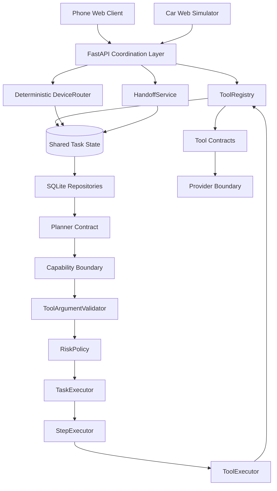

# Architecture Summary

FlowMate is Task-centered: Phone Web and Car Simulator are independent surfaces around one shared Task. The coordination layer is separate from planning, validation, risk, execution and providers so device handoff cannot bypass Agent safety semantics.

## Planner Layer

RuleBasedPlanner and LLMPlanner both implement the same contract: `plan(user_input: str) -> Task`. The LLM does not create internal execution state directly. It produces a planned schema that Python validates and converts into Task, PlanStep and ToolCall.

## Runtime Layer

TaskExecutor only executes already planned Tasks. StepExecutor only executes one PlanStep. ToolExecutor only executes one ToolCall through ToolRegistry. This keeps orchestration explicit and testable.

## Provider Layer

Tools depend on provider abstractions. Mock providers support deterministic demos and tests. Real providers handle Google Calendar, Open-Meteo, Amap and Feishu adapter integration without leaking vendor details into Planner or frontend.

## Product Point

The architecture is designed for controlled agency and Task continuity: the same Task/context can change device surface, while side effects still pass through deterministic risk, optimistic concurrency and human confirmation boundaries.
