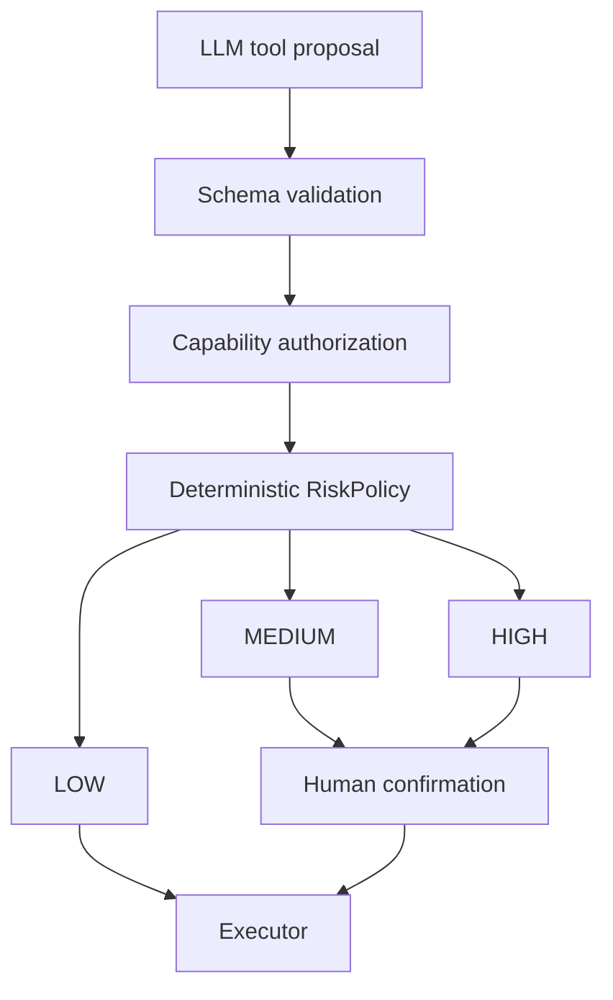

# Safety Model

FlowMate treats model output as a proposal, not authority.

## Boundaries

- Capability authorization rejects unsupported tools and unsupported actions.
- Tool schemas validate arguments before execution.
- RiskPolicy is deterministic backend code.
- LLM-generated risk metadata is not trusted.
- Notification, smart-home and vehicle actions can require human confirmation.
- Rejected tasks are cancelled and no side effect is executed.

## Risk Levels

| Risk | Meaning | Behavior |
| --- | --- | --- |
| LOW | Informational read or low-impact planning | Can execute when task status allows |
| MEDIUM | User-visible side effect or home automation action | Requires HITL |
| HIGH | Vehicle action or high-impact control | Requires stronger visible warning and HITL |

## Why HITL Is Backend-owned

The frontend renders confirmation state, but it does not decide confirmation rules. The backend TaskConfirmationService owns transitions so browser UI cannot bypass safety by changing local state.
